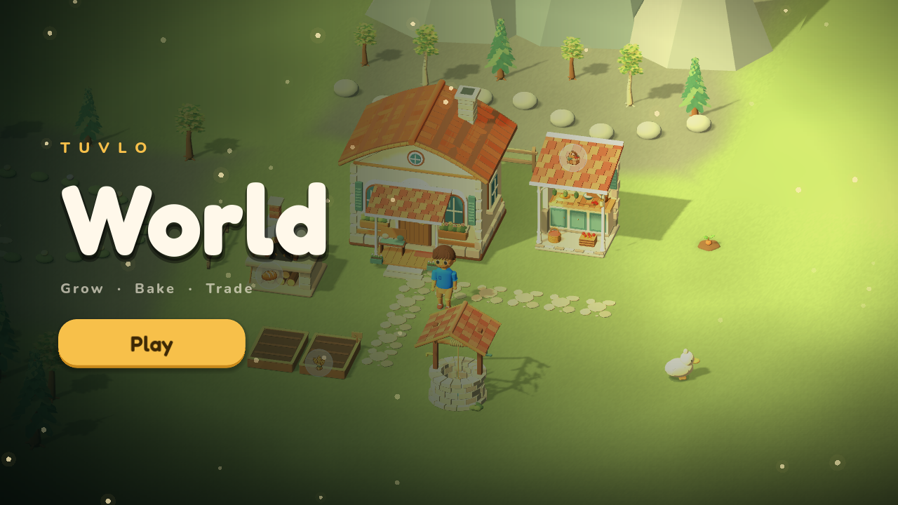
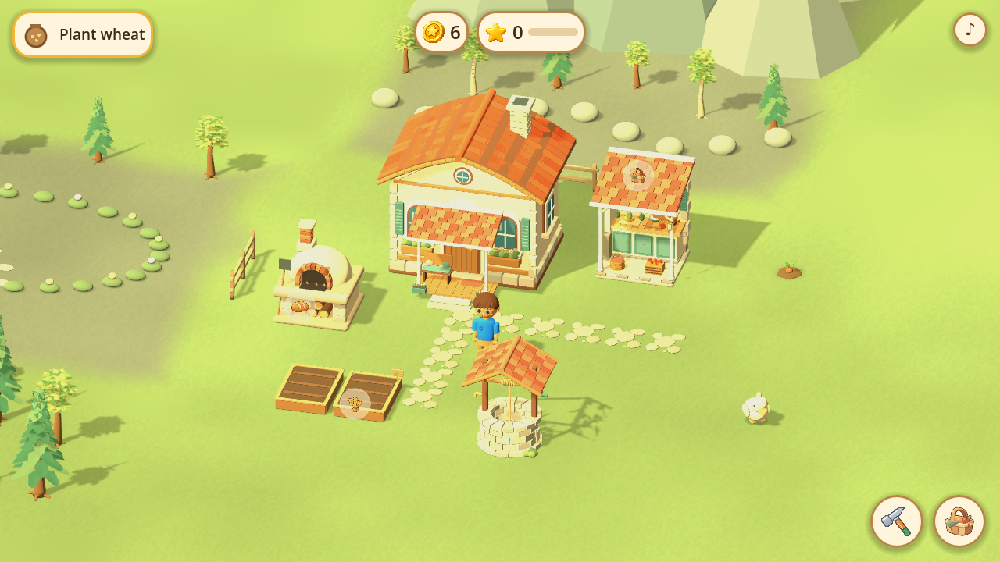
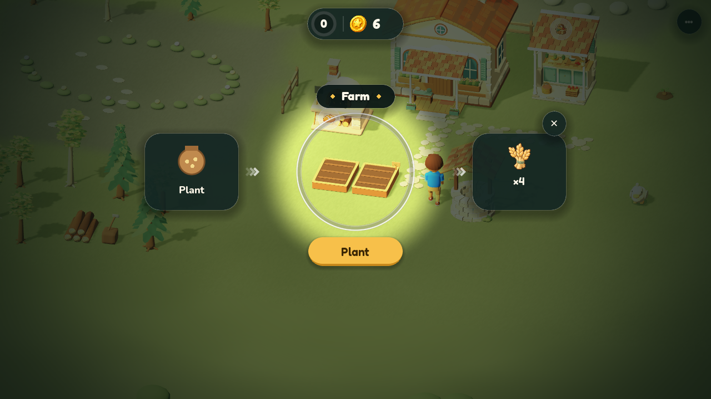
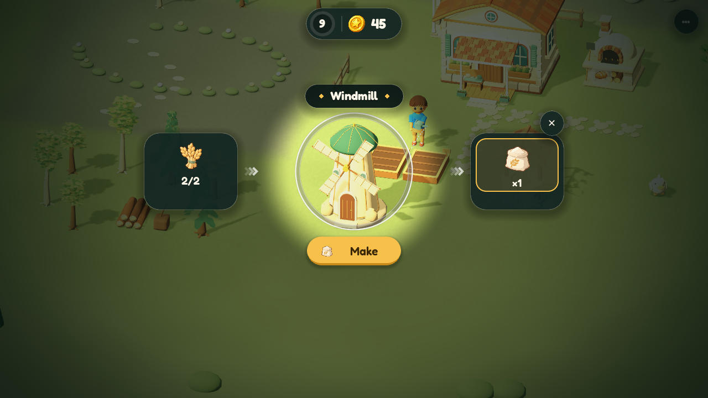
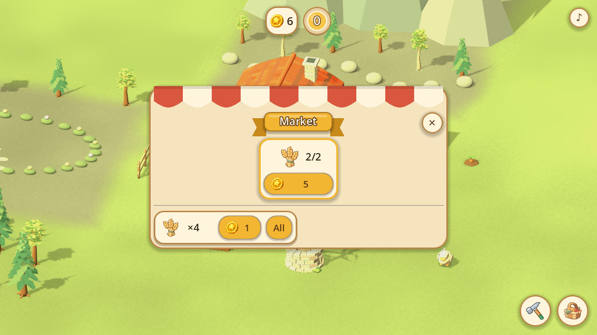
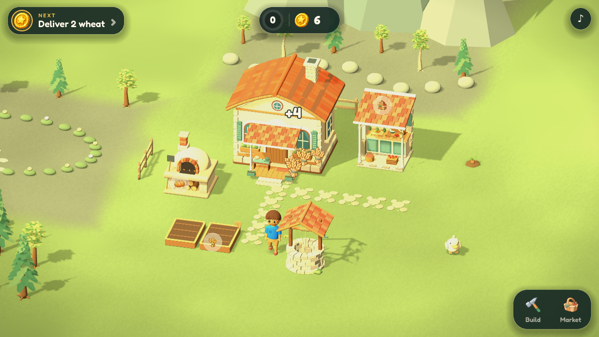
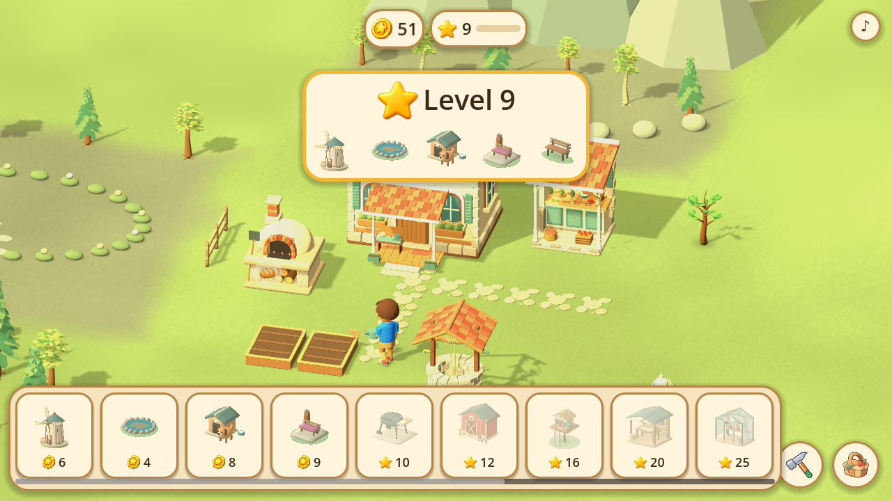
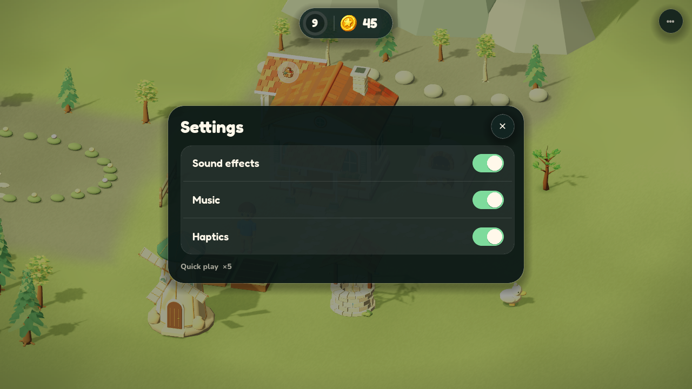

# Tuvlo World

A cozy homestead game for iPhone and iPad: build places, grow and make goods with short timers, and sell them at the market. Everyone can play it as a standalone game. It also runs as the World inside the Tuvlo family app.

Owner decision (2026-11-04): **all-Godot game, thin Swift shell.** Godot holds the world, the rules and every game menu. Native code only provides purchases, saves and launch through a small host interface. The same game later plugs into Tuvlo, which answers the same interface with its own Coins, Stars, missions and receipts.

| Folder | What it is |
| --- | --- |
| `Godot/` | The game project (Godot 4.7). Imported from Tuvlo's `WorldRuntime/Godot` with its history. |
| `Authoring/` | Reproducible art sources (Blender scripts) for the models in `Godot/assets`. |
| `reference/tuvlo-swift/` | A **read-only** copy of Tuvlo's SwiftUI World menus and rules (Tuvlo `b50d5f57`). It's the spec for porting into Godot, it isn't built, and it gets deleted once the port is done. |
| `docs/` | [Architecture and host interface](docs/ARCHITECTURE.md), the [porting plan](docs/PORTING-PLAN.md) and how to [run and test](docs/RUN.md). |
| `scripts/` | `run-mac.sh` to play and `test.sh` to run the rules tests. |

| Title | Start, with the goal ticket |
| --- | --- |
|  |  |
| **Farm card** | **Windmill card** |
|  |  |
| **Market stall and orders** | **Harvest flies to the Market** |
|  |  |
| **Build dock and level-up** | **Settings** |
|  |  |

The interface uses dark glass panels with ivory type in [Fredoka](https://fonts.google.com/specimen/Fredoka) and [Nunito](https://fonts.google.com/specimen/Nunito) (both SIL Open Font License; licences in `Godot/assets/fonts`).

Tuvlo keeps its own World unchanged until the owner decides to converge the two. See Tuvlo's `docs/design/STANDALONE-WORLD-PLAN.md`.
